# Bản đồ Tính năng & Ma trận Đối sánh Năng lực Cạnh tranh (CreamTranslator Feature Map)

Tài liệu này là Bản đồ Tính năng (Feature Map) và Ma trận Đối sánh Năng lực Cạnh tranh (Competitive Benchmarking Matrix) chính thức của **CreamTranslator**, được tổng hợp từ quá trình nghiên cứu, phân tích chuyên sâu 5 ứng dụng dịch màn hình hàng đầu trên nền tảng Android.

---

## 1. Tổng quan Định vị Sản phẩm (Product Positioning)

**CreamTranslator** là công cụ dịch màn hình Android tốc độ cao, xử lý cục bộ hoàn toàn (100% On-Device), không phát sinh bất kỳ chi phí duy trì nào và miễn nhiễm tuyệt đối với hệ thống Anti-Cheat của các tựa game di động.

### Triết lý Thiết kế Cốt lõi (Core Design Pillars)
1. **Zero-Cost & 100% On-Device**: Không quảng cáo xen ngang gián đoạn, không phí thuê bao định kỳ, không yêu cầu thiết lập API key đám mây. Mọi tác vụ nhận diện ký tự và dịch thuật đều diễn ra ngoại tuyến trên thiết bị thông qua Google ML Kit On-Device v2.
2. **Zero-Accessibility & Anti-Cheat Safe**: Loại bỏ hoàn toàn sự phụ thuộc vào `AccessibilityService`. Chỉ sử dụng cơ chế chụp màn hình tiêu chuẩn `MediaProjection` kết hợp cửa sổ nổi độc lập, giúp game thủ an tâm tuyệt đối trước các bộ quét chống gian lận như Tencent ACE, HoYoverse Protection, NetEase, EasyAntiCheat.
3. **In-Place Smart Replacement**: Thuật toán lấy mẫu màu viền nền thông minh (`TextInpainter`) thay thế văn bản trực tiếp vào đúng tọa độ của hộp thoại game, kết hợp cơ chế tự động co giãn kích thước chữ theo mật độ ký tự.
4. **Local-First Privacy & High Reliability**: Dữ liệu hình ảnh và nhật ký chẩn đoán chỉ lưu trữ cục bộ trong RAM và tệp xoay vòng tối đa 2MB; quy trình kiểm thử tự động nghiêm ngặt với Harness Engineering, Konsist và Property-Based Testing (Kotest).

---

## 2. Ma trận Đối sánh Năng lực Cạnh tranh (Competitive Benchmarking Matrix)

Dưới đây là bảng đối sánh kỹ thuật chi tiết giữa **CreamTranslator** và 5 ứng dụng dịch màn hình Android phổ biến nhất hiện nay:

| Tiêu chuẩn Kỹ thuật | CreamTranslator (Hiện tại) | Tap To Translate Screen | Ever Translator | Bubble Screen Translate | Kaku Japanese OCR | Instant Translate on Screen |
| :--- | :--- | :--- | :--- | :--- | :--- | :--- |
| **Cơ chế chụp màn hình** | `MediaProjection` độc lập | `MediaProjection` + `AccessibilityService` | `MediaProjection` | `MediaProjection` | `MediaProjection` | `AccessibilityService` chủ đạo |
| **Mức độ an toàn Anti-Cheat** | **An toàn 100%** (Không dùng Accessibility) | Nguy cơ cao (Bị cờ quét của Anti-Cheat phát hiện) | Khá an toàn | Khá an toàn | Khá an toàn | **Nguy cơ rất cao** (Dễ bị khóa tài khoản do can thiệp view tree) |
| **Mô hình chi phí & Quảng cáo** | **0 đồng vĩnh viễn** (Không quảng cáo, không subscription) | Quảng cáo video dày đặc, gói VIP trả phí theo tháng | Quảng cáo banner/popup, gói trả phí theo tháng | Tích điểm theo lượt dịch hoặc trả phí tháng | Miễn phí kèm gói ủng hộ phát triển | Trả phí thuê bao định kỳ, quảng cáo thường xuyên |
| **Động cơ nhận diện OCR** | Google ML Kit v2 On-Device (Cục bộ) | ML Kit + Cloud Baidu/Google OCR | Offline Tesseract + Cloud OCR | Manga Specialized Cloud/Local OCR | Tesseract Offline | Google Cloud Vision / ML Kit |
| **Động cơ Dịch thuật** | Google ML Kit On-Device Neural Model | Google / DeepL / Baidu Cloud API | Google / DeepL Cloud API | DeepL / Google / Sugoi (Cloud/Local) | Từ điển nội bộ JMdict (Tra cứu từ) | Google Cloud API |
| **Khả năng hoạt động Ngoại tuyến** | **100% Offline** (Gói mô hình nơ-ron ~30MB) | Yêu cầu kết nối Internet cho bản dịch nâng cao | Chỉ hỗ trợ offline câu ngắn cơ bản; phần lớn cần mạng | Bắt buộc có kết nối mạng để dịch | 100% Offline (chuyên tra cứu tiếng Nhật) | Bắt buộc kết nối Internet liên tục |
| **Hình thức hiển thị bản dịch** | **In-Place Inpainting** (Đè trực tiếp vào khung thoại) | Hộp thoại nổi / Thẻ đen che khuất màn hình | Thẻ nổi / Inpainting cơ bản | Inpainting bóng thoại truyện tranh | Pop-up hiển thị nghĩa từ vựng tại chỗ | Hộp thoại nổi / Thay thế ô nhập văn bản |
| **Tự động cân chỉnh màu nền** | Có (Lấy mẫu viền tự động, tính độ tương phản chữ) | Không (Chỉ phủ một khung chữ nhật màu đen đơn sắc) | Có (Phủ màu đồng nhất đơn giản) | Có (Tối ưu riêng cho bóng thoại manga) | Không (Chỉ tra nghĩa) | Không |
| **Tự động co giãn cỡ chữ** | Có (Dynamic Autoscaling theo mật độ ký tự) | Không | Hạn chế | Có | Không áp dụng | Không |
| **Chuyển đổi Bản gốc / Bản dịch** | **Tap-to-Toggle** (Chạm trực tiếp vào chữ để lật) | Không (Phải đóng mở lại overlay) | Xem song song hoặc ẩn hiện | Xem song song | Chạm từng từ đơn lẻ | Đóng mở hộp thoại |
| **Dịch theo vùng chọn (Region)** | Có (`RegionTranslateController` + Double-Tap 300ms + `RegionSelectorView`) | Có | Có | Có | Có (Khung ngắm kéo thả) | Có |
| **Chế độ Tự động quét (Auto-Scan)**| Chưa hỗ trợ (Đang trong lộ trình v2.0) | Có (Quét lặp theo chu kỳ giây) | Có (Hẹn giờ quét theo chu kỳ) | Có (Quét khi khung hình biến đổi) | Không | Có |
| **Nhật ký hội thoại (Dialogue Log)**| Chưa hỗ trợ (Đang trong lộ trình v2.0) | Không | Hạn chế | Có (Lưu lịch sử các khung thoại) | Có (Xuất bộ thẻ Anki Deck) | Không |
| **Mức tiêu thụ bộ nhớ RAM** | **Tối ưu nhẹ** (< 120MB Heap) | Trung bình - Nặng (180MB - 300MB) | Trung bình (150MB - 250MB) | Nặng (250MB - 450MB) | Nhẹ (~100MB) | Trung bình (160MB - 220MB) |
| **Bảo mật & Quyền riêng tư** | **Tuyệt đối** (Không truyền mạng, LogSanitizer) | Gửi dữ liệu ảnh chụp lên máy chủ bên thứ ba | Gửi ảnh màn hình lên Cloud API | Gửi hình ảnh lên máy chủ phân tích | Lưu trữ cục bộ | Đọc cấu trúc màn hình từ View Hierarchy |

---

## 3. Phân tích Điểm vượt trội & Khoảng trống Năng lực (Moats & Gap Analysis)

### 3.1. Điểm Vượt trội Cốt lõi của CreamTranslator (Core Moats)
1. **Miễn nhiễm Anti-Cheat tuyệt đối**:
   Các tựa game di động phổ biến hiện nay (Genshin Impact, Honkai: Star Rail, Wuthering Waves, PUBG Mobile, Arena of Valor) đều tích hợp hệ thống phát hiện hành vi can thiệp trái phép. Việc CreamTranslator kiên quyết không cấp quyền `AccessibilityService` giúp người dùng hoàn toàn tránh khỏi nguy cơ bị cấm tài khoản.
2. **Kinh tế & Trải nghiệm Liền mạch**:
   Không thu phí duy trì, không bán gói thành viên VIP, không chèn banner hoặc video quảng cáo gây gián đoạn combat trong game.
3. **Hiển thị Thay thế Tự nhiên (In-Place Inpainting)**:
   Thay vì đặt một tấm bảng đen to lớn che mất tầm nhìn, CreamTranslator đo màu nền viền hộp thoại và vẽ chữ dịch đè lên vị trí cũ với phông chữ tự động co giãn, tạo cảm giác như đang chơi một bản game đã được bản địa hóa chính thức.
4. **Hành lang Kỹ thuật Chuẩn mực (Harness Engineering)**:
   Ứng dụng sở hữu bộ rào chắn kiến trúc tự động bằng Konsist, kiểm thử đặc tính tự sinh dữ liệu (Property-Based Tests với Kotest) và hệ thống chẩn đoán đệm vòng không rò rỉ bộ nhớ, bảo đảm độ ổn định cao trên Android 14+.

### 3.2. Các Khoảng trống Cần Nâng cấp & Mở rộng (Capability Gaps)
Để đáp ứng trọn vẹn mọi nhu cầu của game thủ và người đọc truyện, CreamTranslator đã xác định 6 khoảng trống cần bù đắp:
1. **Bổ sung các gói ngôn ngữ ngoại tuyến**: Mở rộng từ cặp Tiếng Anh <-> Tiếng Việt sang Tiếng Nhật (JA -> VI), Tiếng Trung (ZH -> VI), Tiếng Hàn (KO -> VI).
2. **Lớp đệm thao tác an toàn (RFC-001 Radial Quick Action Menu)**: Chống thao tác tắt nhầm ứng dụng khi đang combat và tạo không gian cho các nút chức năng nhanh.
3. **Tự động quét theo biến thiên khung hình (Screen-Diff Trigger)**: Tự động phát hiện khi dòng thoại trong game chuyển cảnh để dịch ngay mà không cần chạm tay vào nút nổi liên tục.
4. **Sổ tay thuật ngữ game (Glossary Engine)**: Cho phép người chơi tự cấu hình dịch cố định tên nhân vật, vật phẩm, kỹ năng để tránh AI dịch máy ngô nghê.
5. **Nhật ký hội thoại & Đọc âm thanh (Dialogue History & Offline TTS)**: Lưu trữ các câu thoại đã đọc để người chơi xem lại cốt truyện và hỗ trợ giọng đọc tiếng Việt ngoại tuyến.
6. **Nhận diện văn bản dọc (Vertical Text OCR)**: Hỗ trợ tối ưu cho các khung thoại dọc trong truyện tranh manga và tiểu thuyết mạng.

---

## 4. Bản đồ Tính năng 4 Tầng (CreamTranslator 4-Tier Feature Map)

```mermaid
flowchart TD
    subgraph T1["Tầng 1: Nền tảng Cốt lõi & An toàn (v1.0 - v1.3) [ĐÃ HOÀN THÀNH]"]
        T1A["Chụp màn hình chuẩn MediaProjection độc lập"]
        T1B["Google ML Kit On-Device OCR & Dịch nơ-ron Offline"]
        T1C["In-Place Inpainting & Tự động co giãn cỡ chữ"]
        T1D["Chạm lật bản gốc Tap-to-Toggle & Kéo vùng chọn Region"]
        T1E["Ghi log cục bộ, che mờ dữ liệu nhạy cảm LogSanitizer"]
        T1F["Trình tự cập nhật trong ứng dụng In-App OTA"]
        T1G["Hệ thống kiểm thử Konsist & Property-Based Testing"]
    end

    subgraph T2["Tầng 2: Công thái học & Cá nhân hóa (v1.4 - v1.5) [NGẮN HẠN]"]
        T2A["RFC-001: Menu nan quạt nổi Radial Arc Menu"]
        T2B["Tùy chỉnh độ đục/trong suốt, màu sắc & viền chữ inpainting"]
        T2C["Giao diện tùy biến danh sách từ loại trừ & Regex trên UI"]
        T2D["Bổ sung gói ngôn ngữ Offline: Tiếng Nhật, Trung, Hàn"]
        T2E["Chế độ dải thanh phụ đề cố định (Subtitle Bar Mode)"]
    end

    subgraph T3["Tầng 3: Tự động hóa & Trải nghiệm Game (v2.0) [TRUNG HẠN]"]
        T3A["Tự động quét theo biến thiên khung hình Screen-Diff"]
        T3B["Nhật ký theo dõi cốt truyện Dialogue History Log"]
        T3C["Sổ tay thuật ngữ game tùy biến Glossary Engine"]
        T3D["Phát âm thoại nhân vật ngoại tuyến Offline TTS"]
        T3E["Hỗ trợ nhận diện chữ dọc Manga Vertical OCR"]
    end

    subgraph T4["Tầng 4: Hệ sinh thái Đa phương thức (v2.5+) [DÀI HẠN]"]
        T4A["Cổng kết nối AI đám mây tùy chọn BYOK (GPT-4o, Claude, DeepSeek, Gemini)"]
        T4B["Phân tách và tẩy trắng bóng thoại truyện tranh nâng cao"]
        T4C["Xuất bộ thẻ Anki Flashcards học ngoại ngữ từ game"]
        T4D["Chia sẻ và đồng bộ hồ sơ thuật ngữ game cộng đồng"]
    end

    T1 --> T2
    T2 --> T3
    T3 --> T4
```



---

## 5. Đặc tả Chi tiết các Tầng Năng lực

### Tầng 1: Nền tảng Cốt lõi & An toàn Hệ thống (Current Production: v1.0 - v1.3+)
Trạng thái: **Đã triển khai hoàn tất và kiểm chứng ổn định trên môi trường thực tế**.
- **Chụp màn hình an toàn**: `ScreenCaptureManager` tích hợp bộ lắng nghe trạng thái và tự động tính toán lại tỷ lệ `VirtualDisplay` khi xoay ngang/dọc, tuân thủ nghiêm ngặt bất biến của Android 14+. Hỗ trợ `captureRegion(Rect)` cắt vùng chọn an toàn kèm giải phóng `Bitmap` gốc (`cropped !== full`).
- **Pipeline xử lý cục bộ**: Kết nối trực tiếp với Google ML Kit On-Device v2; tốc độ nhận diện và dịch Tiếng Anh - Tiếng Việt đạt độ trễ trung bình dưới 350ms. Hỗ trợ `PixelOffset` ánh xạ tọa độ từ vùng crop về không gian màn hình tuyệt đối sau bước lấy mẫu màu nền.
- **Vẽ đè thông minh**: `InPlaceTranslationOverlay` phối hợp cùng `TextInpainter` lấy mẫu màu viền nền của hộp thoại, tính toán độ tương phản để chọn màu chữ tối ưu và render bằng `StaticLayout`.
- **Tương tác linh hoạt**: Hỗ trợ chạm đơn để dịch toàn bộ màn hình, chạm đôi nút nổi (300ms) để kích hoạt chọn vùng (`RegionTranslateController` + `RegionSelectorView` có lớp nền tối, hủy khi chạm nhẹ và auto-dismiss 10 giây), chạm vào ô dịch để đổi nhanh giữa tiếng Việt và tiếng Anh gốc.
- **Độ tin cậy kỹ thuật**: Giám sát cục bộ qua `PipelineTracer`, đệm xoay vòng 2MB không rò rỉ bộ nhớ, kiểm thử Konsist bảo vệ ranh giới kiến trúc và 100% test JVM pass.

#### Chuẩn hóa Kiến trúc & Phòng ngừa Lỗi khi Triển khai Region Translate
7 điểm gia cố kỹ thuật đã được chuẩn hóa thành bất biến cho các tính năng lớp phủ tiếp theo:
1. **Phân tách cử chỉ Double-Tap (300ms)**: Dùng sentinel `-1L` thay vì `0L` để tránh nhận nhầm lần chạm đầu khi `uptimeMillis() < 300ms`, tách biệt hoàn toàn với Long-Press (800ms).
2. **Đồng bộ cờ Window Cutout**: `RegionSelectorView` sử dụng chung `FLAG_LAYOUT_IN_SCREEN | FLAG_LAYOUT_NO_LIMITS` và `layoutInDisplayCutoutMode` với `InPlaceTranslationOverlay` để không lệch tọa độ trên thiết bị có notch/punch-hole.
3. **Cơ chế thoát an toàn**: Tự động hủy khi vùng kéo nhỏ hơn ngưỡng (`<= 20px`), khi `ACTION_CANCEL`, hoặc khi hết thời gian chờ 10 giây (hủy coroutine tại `onDetachedFromWindow()`).
4. **Tuân thủ Thin Host**: Toàn bộ luồng dịch vùng được cô lập trong `RegionTranslateController`, không đặt logic nghiệp vụ trong `OverlayService`.
5. **Model thuần Kotlin**: Dùng `PixelOffset` trong `core.model` thay cho `android.graphics.Point` để giữ tầng Core kiểm thử được 100% trên JVM.
6. **Guard trạng thái `RegionSelecting`**: Ngăn pipeline toàn màn hình và pipeline vùng chạy song song.
7. **Thứ tự lấy mẫu màu & Bitmap lifecycle**: Lấy mẫu màu nền trên tọa độ gốc của bitmap crop trước khi cộng `PixelOffset`, và chỉ `recycle()` bitmap toàn màn hình khi `cropped !== full`.

---

### Tầng 2: Công thái học & Cá nhân hóa Điều khiển (Mục tiêu v1.4 - v1.5)
Trạng thái: **Đang chuẩn bị triển khai theo lộ trình ngắn hạn**.
- **Menu nan quạt Quick Action (RFC-001)**:
  - Khi nhấn giữ nút nổi 600ms, bung ra menu hình cánh cung (Arc Menu) tự động xoay hướng vào trong màn hình dựa trên vị trí dính mép trái/phải.
  - Tích hợp 4 nút hành động: [Tắt dịch an toàn], [Mở ứng dụng chính], [Kích hoạt kéo vùng chọn], [Đổi nhanh ngôn ngữ].
  - Triệt tiêu 100% rủi ro tắt nhầm dịch vụ khi ngón tay tì vào nút nổi trong lúc chơi game.
- **Bảng điều khiển cá nhân hóa giao diện hiển thị**:
  - Cho phép người dùng chỉnh độ trong suốt của nền inpainting (`50% - 100%`).
  - Cho phép cài đặt kích thước phông chữ tối thiểu/tối đa theo sở thích cá nhân.
  - Bổ sung tùy chọn vẽ viền chữ (Text Stroke) để chữ dịch luôn nổi bật trên nền game có hoạt ảnh chuyển động phức tạp.
- **Trình quản lý quy tắc lọc văn bản tùy biến (Filter Management UI)**:
  - Giao diện trực quan để người dùng thêm bớt các từ không muốn dịch (như tên nhân vật, chỉ số FPS, nhãn nút điều khiển).
  - Hỗ trợ nhập mẫu Regex đơn giản để lọc bỏ chỉ số máu (HP), năng lượng (MP), sát thương và tiền vàng.
- **Mở rộng các gói ngôn ngữ ngoại tuyến**:
  - Tích hợp thêm các bộ mô hình dịch nơ-ron cục bộ của Google ML Kit: Tiếng Nhật (JA -> VI), Tiếng Trung (ZH -> VI), Tiếng Hàn (KO -> VI).
  - Xây dựng trình tải gói ngôn ngữ theo yêu cầu (On-demand Downloader) để tối ưu dung lượng bộ nhớ máy của người dùng.
- **Chế độ Dải phụ đề cố định (Subtitle Bar Mode)**:
  - Bổ sung tùy chọn hiển thị bản dịch tập trung vào một thanh nổi cố định nằm ở đáy hoặc đỉnh màn hình, phù hợp cho người dùng muốn giữ nguyên 100% hình ảnh đồ họa của game.

---

### Tầng 3: Tự động hóa & Trải nghiệm Game Chuyên sâu (Mục tiêu v2.0)
Trạng thái: **Kế hoạch phát triển trung hạn**.
- **Tự động quét theo biến thiên khung hình (Screen-Diff Auto-Translate)**:
  - Áp dụng thuật toán so sánh khung hình nhanh (Fast Perceptual Hash hoặc Structural Similarity Index trên vùng hộp thoại) với mức tiêu thụ CPU cực thấp (< 2%).
  - Khi nhân vật chuyển sang câu thoại tiếp theo, hệ thống tự động kích hoạt dịch mà người chơi không cần nhấc tay chạm vào màn hình.
- **Nhật ký cốt truyện (Dialogue History Log)**:
  - Cung cấp một cửa sổ nổi thu nhỏ ghi lại 50 câu thoại gần nhất kèm bản gốc và bản dịch.
  - Giúp game thủ dễ dàng đọc lại khi lỡ tay nhấn nút bỏ qua (Skip) cốt truyện.
- **Sổ tay thuật ngữ game (Glossary Engine & Terminology Override)**:
  - Cho phép thay thế thuật ngữ trước và sau khi dịch: Tên riêng, kỹ năng, vật phẩm, trang bị.
  - Hỗ trợ lưu trữ theo từng hồ sơ (Profile) riêng biệt cho từng tựa game.
- **Phát âm thoại ngoại tuyến (Offline TTS Integration)**:
  - Tận dụng Text-To-Speech nội bộ của Android để đọc to bản dịch tiếng Việt cho người dùng muốn nghe giọng đọc tự nhiên.
- **Nhận diện chữ dọc truyện tranh (Vertical Text OCR)**:
  - Cải tiến thuật toán gom cụm dòng chữ (`LineClustering`) để xử lý văn bản xếp theo chiều dọc trong truyện tranh Nhật Bản và tiểu thuyết Trung Quốc.

---

### Tầng 4: Hệ sinh thái Đa phương thức & Mở rộng (Mục tiêu v2.5+)
Trạng thái: **Tầm nhìn dài hạn**.
- **Cổng kết nối AI đám mây tùy chọn (BYOK - Bring Your Own Key)**:
  - Giữ vững bản chất cốt lõi 100% On-Device cho mọi tính năng mặc định.
  - Mở rộng thêm cổng tùy chọn cho người dùng muốn tự nhập API Key cá nhân (OpenAI GPT-4o, Anthropic Claude, Google Gemini, DeepSeek) để dịch những tác phẩm văn học cổ điển hoặc game có lời thoại giàu chất thơ.
- **Phân đoạn và xử lý bóng thoại chuyên nghiệp (Manga Bubble Inpainting)**:
  - Áp dụng mô hình nhận diện hình học bong bóng thoại, tự động xóa sạch nét chữ gốc và căn lề chữ dịch uốn lượn khớp theo đường cong bóng thoại.
- **Xuất thẻ học ngoại ngữ (Anki / Flashcards Export)**:
  - Chạm giữ vào một từ hoặc cụm từ dịch để xuất nhanh sang bộ thẻ Anki, biến quá trình chơi game thành cơ hội học ngoại ngữ thực tế.
- **Chia sẻ bộ thuật ngữ cộng đồng (Community Glossary Hub)**:
  - Cho phép người chơi xuất và chia sẻ tệp cấu hình thuật ngữ game định dạng `.json` hoặc `.zip` với bạn bè trong cộng đồng.

---

## 6. Đánh giá Tác động Kiến trúc & Kế hoạch Kiểm soát Rủi ro

| Tính năng Đề xuất | Tác động Kiến trúc (Architectural Impact) | Mức độ Rủi ro | Giải pháp Kiểm soát & Kiểm thử |
| :--- | :--- | :--- | :--- |
| **Radial Menu (RFC-001)** | Bổ sung `QuickActionMenuView`, mở rộng State Machine của `OverlayService`. | Thấp | Kiểm thử trạng thái với Robolectric; cơ chế tự động thu gọn khi chạm ra ngoài hoặc quá thời gian chờ (5s). |
| **Mở rộng Gói ngôn ngữ Offline** | Quản lý vòng đời tải về, nạp bộ nhớ và giải phóng model của `MlKitTranslationEngine`. | Trung bình | Đảm bảo tại một thời điểm chỉ tải đúng 1 mô hình ngôn ngữ vào RAM; kiểm tra giải phóng tài nguyên triệt để. |
| **Giao diện Quản lý Filter & Glossary** | Mở rộng `FilterConfig` và `FilterPreferencesRepository` lưu vào DataStore. | Thấp | Kiểm thử Property-Based Testing để đảm bảo việc thay thế từ khóa không tạo ra vòng lặp chuỗi vô tận. |
| **Tự động quét Screen-Diff** | Tính toán so sánh định kỳ trên luồng hình ảnh. | Cao (Nguy cơ gây nóng máy hoặc hao pin) | Chỉ tính toán trên vùng crop nhỏ của hộp thoại; áp dụng cơ chế điều tiết (Throttling tối thiểu 1.5s giữa các lần kiểm tra) và tạm dừng khi màn hình tĩnh. |
| **Cổng AI Đám mây BYOK** | Mở rộng `TranslationEngine` interface với implementation Cloud HTTP client. | Thấp | Tuân thủ nghiêm ngặt nguyên tắc Interface-First; chế độ Cloud là tùy chọn độc lập, không xâm lấn vào core Offline mặc định. |

---

## 7. Lộ trình Triển khai Tổng thể (Milestone Roadmap)

```
[v1.0 - v1.3] Nền tảng On-Device & An toàn Hệ thống (Hiện tại)
      │
      ▼
[v1.4 - v1.5] Menu Nan Quạt Radial Arc (RFC-001) + Tùy chỉnh Hiển thị + Gói Ngôn ngữ JA/ZH/KO
      │
      ▼
[v2.0]        Tự động quét Screen-Diff + Nhật ký Cốt truyện Dialogue Log + Sổ tay Thuật ngữ Game
      │
      ▼
[v2.5+]       Cổng AI Đám mây BYOK + Phân tách Bóng thoại Manga + Xuất Flashcards Học tập
```
