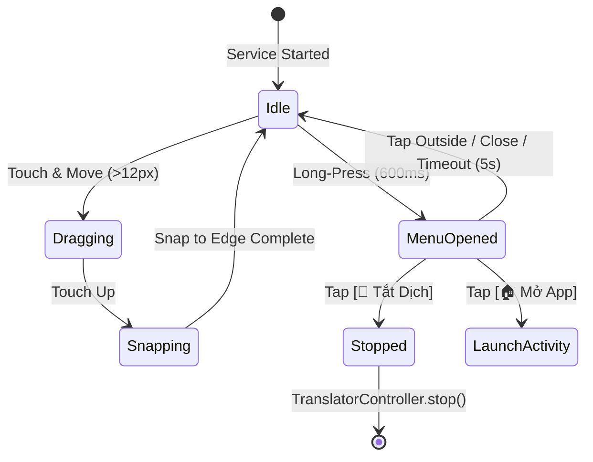

# RFC-001: Floating Quick Action Menu (Lớp đệm điều khiển nút nổi)

- **Trạng thái**: Proposed (Bản thảo đề xuất)
- **Ngày tạo**: 2026-11-24
- **Tác giả**: CreamTranslator Architecture Team
- **Phạm vi tác động**: `OverlayService`, `WindowManager`, Floating Control UI

---

## 1. Bối cảnh & Động lực (Context & Motivation)

### 1.1. Vấn đề của cơ chế nhấn giữ trực tiếp (Direct Long-Press Shutdown)
Hiện tại, thao tác nhấn giữ (Long-press 800ms) trên nút nổi (`floatingTriggerView`) sẽ kích hoạt tắt dịch vụ ngay lập tức (`TranslatorController.stop()`). Mặc dù cơ chế đã phân biệt được giữa kéo thả di chuyển (`ACTION_MOVE` > 12px) và nhấn giữ yên vị trí, nó vẫn tiềm ẩn 2 nhược điểm lớn trong trải nghiệm người dùng:
1. **Nguy cơ tắt nhầm (Accidental Shutdown)**: Trong các trận game căng thẳng, người dùng có thể tì ngón tay lên nút nổi trong giây lát khi đang quan sát mà chưa kịp kéo, dẫn đến việc ứng dụng bị tắt ngoài ý muốn.
2. **Thiếu không gian mở rộng tính năng (Zero Extensibility)**: Nút nổi là điểm chạm duy nhất của CreamTranslator trên màn hình khi người dùng chơi game. Nếu nút nổi chỉ phục vụ 2 thao tác cứng (Chạm đơn = Dịch, Giữ lâu = Tắt), ứng dụng sẽ không thể bổ sung thêm các tính năng quan trọng khác mà không làm vỡ kiến trúc thao tác chạm.

### 1.2. Mục tiêu đề xuất (Proposal Goals)
Thiết kế một **Lớp đệm điều khiển nổi (Quick Action Menu)** xuất hiện khi người dùng nhấn giữ nút nổi:
- Cung cấp bước xác nhận đệm trực quan trước khi tắt, loại bỏ hoàn toàn rủi ro tắt nhầm.
- Xây dựng kiến trúc module dạng khe cắm (Action Slots) để dễ dàng tích hợp các tính năng trong tương lai.

---

## 2. Thiết kế Trải nghiệm Người dùng & Hình học (UX & Geometry Design)

### 2.1. Phong cách hiển thị nan quạt tròn (Radial / Arc Menu)
Khi người dùng nhấn giữ nút nổi trong khoảng 600ms:
- Nút nổi phát tín hiệu rung nhẹ phản hồi xúc giác (`HapticFeedbackConstants.LONG_PRESS`).
- Menu bung ra theo dạng **vòng cung nan quạt (Arc Menu)** hướng vào bên trong màn hình:
  - Nếu nút nổi đang dính ở **mép trái**: Menu xòe cánh cung về phía bên phải `[0° đến 90°]` hoặc `[-45° đến 45°]`.
  - Nếu nút nổi đang dính ở **mép phải**: Menu xòe cánh cung về phía bên trái `[90° đến 180°]` hoặc `[135° đến 225°]`.

```
        Mép Trái Màn Hình                     Mép Phải Màn Hình
     |                                    |                   |
     |   [🔴 Tắt Dịch]                    |   [🔴 Tắt Dịch]   |
     |         \                          |         /         |
     |   (🔘 Nút Nổi) — [🏠 Mở App]       |   [🏠 Mở App] — (🔘 Nút Nổi)
     |         /                          |         \         |
     |   [🎯 Vùng Dịch]                   |   [🎯 Vùng Dịch]  |
     |                                    |                   |
```

### 2.2. Danh mục các nút hành động (Action Slots)
- **Giai đoạn 1 (Khởi tạo đệm an toàn)**:
  1. 🔴 **Tắt dịch (Stop)**: Biểu tượng nguồn/dừng, gọi `TranslatorController.stop()`.
  2. 🏠 **Mở Dashboard (Open App)**: Khởi chạy `MainActivity` với cờ `FLAG_ACTIVITY_NEW_TASK`.
- **Giai đoạn 2 (Mở rộng tính năng nâng cao)**:
  3. 🎯 **Chọn vùng dịch thủ công (Region Selection)**: Kích hoạt `RegionSelectorView` để quét dịch một góc màn hình tùy chọn thay vì chụp toàn cảnh.
  4. 🌐 **Đổi nhanh ngôn ngữ (Quick Language Switch)**: Chuyển đổi qua lại giữa EN ➔ VI, JA ➔ VI, ZH ➔ VI.

### 2.3. Quy tắc đóng / thu gọn tự động (Auto-Dismiss Rules)
Lớp đệm điều khiển sẽ tự động thu gọn lại trạng thái nút tròn bình thường khi:
- Người dùng chạm vào bất kỳ điểm trống nào ngoài các nút menu.
- Người dùng chạm lại vào nút nổi chính.
- Màn hình bị tắt (`Intent.ACTION_SCREEN_OFF`) hoặc chuyển sang ứng dụng khác (`Intent.ACTION_CLOSE_SYSTEM_DIALOGS`).
- Sau 5 giây nếu người dùng không thao tác bất kỳ nút nào.

---

## 3. Kiến trúc Kỹ thuật & Quản lý Trạng thái (Technical Architecture)



### 3.1. Các thành phần chính (Components)
1. **`QuickActionMenuView`** (`com.cream.translator.ui.overlay.menu`):
   - Custom `ViewGroup` hoặc tập hợp các `ImageView` nổi được quản lý bởi `OverlayService`.
   - Sử dụng `ValueAnimator` với `OvershootInterpolator` để tạo hoạt ảnh bung xòe mượt mà (Staggered Animation ~200ms).
2. **`OverlayService` State Coordination**:
   - Mở rộng State Machine quản lý: `FloatingBubbleState.Collapsed`, `FloatingBubbleState.ExpandedMenu`.
   - Ngăn chặn chụp màn hình khi menu đang mở.

---

## 4. Tiêu chí Nghiệm thu (Acceptance Criteria)

- [ ] Nhấn giữ nút nổi 600ms sẽ rung nhẹ và mở Quick Menu nan quạt, không tự ý tắt dịch vụ ngay.
- [ ] Vị trí các nút menu tự động đảo hướng thông minh dựa vào tọa độ mép trái/phải của nút nổi, không bị văng ra ngoài màn hình.
- [ ] Nhấn nút [🔴 Tắt dịch] thực hiện dọn dẹp tài nguyên và tắt dịch vụ an toàn 100%.
- [ ] Chạm ra ngoài vùng menu lập tức thu gọn menu về nút tròn đơn.
- [ ] Không gây xung đột hay giật lag khi đang chơi game ở 60fps/120fps.
