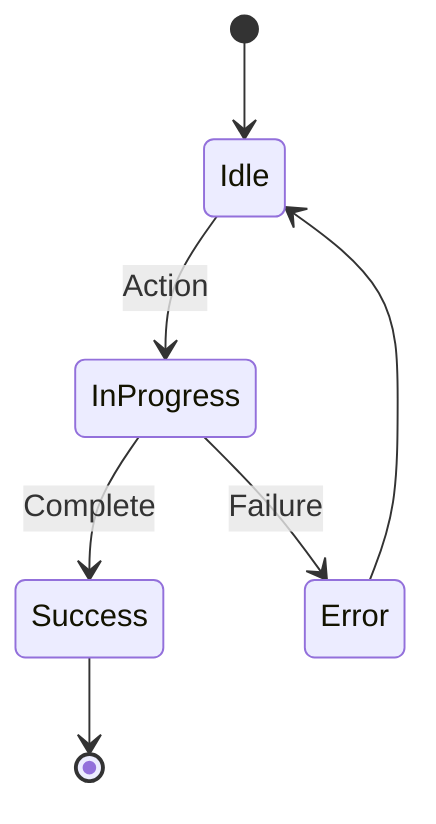

# RFC-XXX: [Tiêu đề Đề xuất Tính năng / Feature Proposal Title]

- **Trạng thái**: [Proposed | Accepted | Implemented | Rejected | Superseded by RFC-YYY]
- **Ngày tạo**: YYYY-MM-DD
- **Tác giả**: [Tên tác giả / Team]
- **Phạm vi tác động**: [Các module, package hoặc service bị ảnh hưởng, ví dụ: OverlayService, Core Engine, UI]

---

## 1. Bối cảnh & Động lực (Context & Motivation)

### 1.1. Vấn đề hoặc Cơ hội phát triển (Problem Statement & Opportunity)
[Mô tả chi tiết vấn đề hiện tại trong trải nghiệm người dùng hoặc cơ hội cải tiến tính năng được phát hiện qua các buổi trao đổi, review hoặc khảo sát.]

### 1.2. Mục tiêu đề xuất (Proposal Goals)
- [Mục tiêu 1: Giải quyết triệt để rủi ro X]
- [Mục tiêu 2: Cung cấp tính năng Y với trải nghiệm mượt mà]
- [Phi mục tiêu (Non-goals): Những gì đề xuất này chủ động không giải quyết]

---

## 2. Thiết kế Trải nghiệm Người dùng (UX & User Flow)

### 2.1. Hành vi tương tác & Luồng người dùng (Interaction Model)
[Mô tả chi tiết cách người dùng kích hoạt, tương tác và kết thúc tính năng. Bao gồm các thao tác chạm, vuốt, cử chỉ hoặc phím bấm.]

### 2.2. Hình học & Trực quan hóa giao diện (Geometry & Visual Layout)
[Sơ đồ bố cục giao diện, vị trí xuất hiện trên màn hình (đặc biệt đối với các lớp phủ Overlay, Floating views).]

```
[ASCII Art hoặc Wireframe minh họa vị trí các phần tử UI trên màn hình]
```

---

## 3. Kiến trúc Kỹ thuật & Quản lý Trạng thái (Technical Architecture)

### 3.1. Sơ đồ trạng thái hoặc luồng xử lý (State Machine / Flowchart)



### 3.2. Thiết kế Module & Hợp đồng Dữ liệu (Components & Data Contracts)
- **[Tên Component 1]**: [Trách nhiệm, API cung cấp]
- **[Tên Component 2]**: [Trách nhiệm, API cung cấp]

---

## 4. Đánh giá Giải pháp Đa chiều (Multi-Dimensional Solution Evaluation)

| Tiêu chí | Đánh giá chi tiết |
| :--- | :--- |
| **Ưu điểm (Pros)** | [Lợi ích lớn nhất về mặt nghiệp vụ và trải nghiệm] |
| **Nhược điểm (Cons)** | [Hạn chế hoặc độ phức tạp thêm vào codebase] |
| **Tác động Kiến trúc (Architectural Impact)** | [Mức độ ảnh hưởng tới các tầng Engine, Service, UI] |
| **Chi phí Bảo trì (Maintenance Overhead)** | [Độ khó trong việc bảo trì và nâng cấp sau này] |
| **Rủi ro Lỗi phụ (Side-effects & Regressions)** | [Khả năng xung đột với các tính năng hiện hữu] |

---

## 5. Lộ trình Triển khai theo Giai đoạn (Phased Roadmap)

- **Giai đoạn 1 (Core / MVP)**: [Các thành phần tối thiểu cần hoàn thiện trước]
- **Giai đoạn 2 (Enhancement)**: [Các tính năng mở rộng bổ trợ]
- **Giai đoạn 3 (Optimization)**: [Tối ưu hóa hiệu năng, animation, telemetry]

---

## 6. Tiêu chí Nghiệm thu (Acceptance Criteria)

- [ ] [Tiêu chí kiểm thử tính năng 1]
- [ ] [Tiêu chí kiểm thử tính năng 2]
- [ ] [Đảm bảo không rò rỉ RAM (Bitmap, Context, Coroutine Scope)]
- [ ] [Tuân thủ quy chuẩn Android 14+ và không gây crash/SecurityException]
